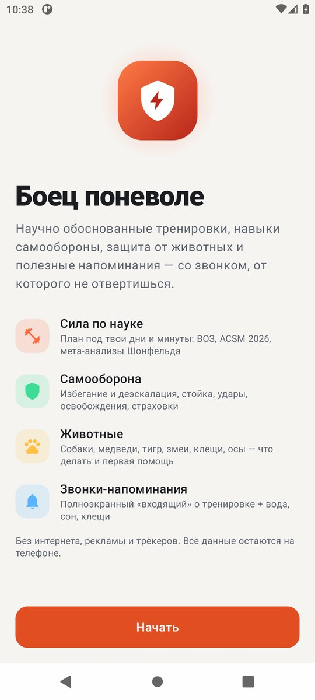
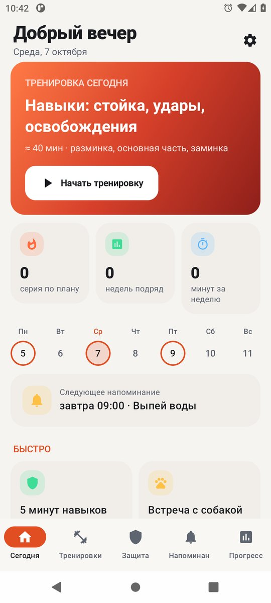
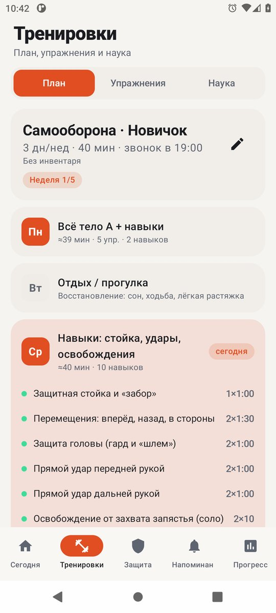
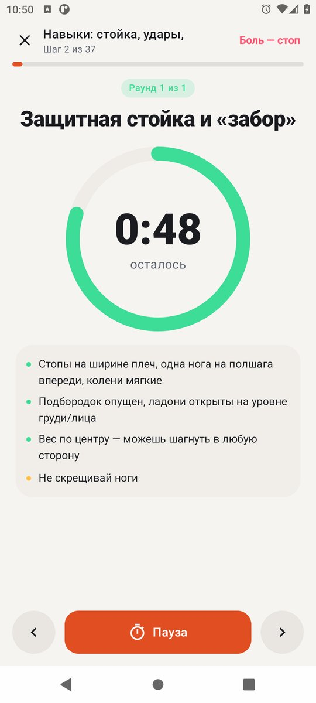
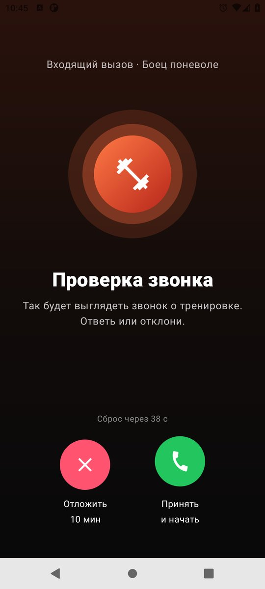
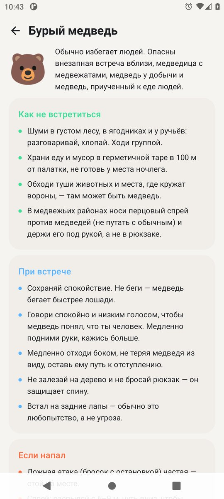

# Боец поневоле

Android-приложение (Kotlin + Jetpack Compose, Android 8.0+) с напоминаниями-«звонками» о тренировках:
научно обоснованная силовая подготовка по мышцам, навыки самообороны, защита от опасных животных
и полезные напоминания. Работает полностью офлайн: в приложении нет разрешения INTERNET, рекламы и трекеров.

<p>
 
 
 
</p>

## Что внутри

**Тренировки**
- План строится автоматически по цели (сила и здоровье / мышцы / сила / самооборона), уровню, дням недели,
  минутам на занятие и инвентарю (без инвентаря, гантели, турник, резина). Каждая мышца — минимум 2 раза в неделю,
  если дней ≥ 2; тренировка всегда укладывается в выбранное время.
- ~55 упражнений по 14 группам мышц: техника, частые ошибки, противопоказания, как упростить и усложнить.
- Дозировка по ACSM 2026 / ACSM 2009 / ВОЗ 2020 и мета-анализам Шонфельда, Грджича: 10–20 подходов на мышцу
  в неделю для гипертрофии, RPE/RIR, отдых 2–3 мин для силы, разминка, двойная прогрессия, разгрузочная неделя
  каждую 5-ю неделю.
- Плеер: таймер работы/отдыха, учёт повторов и RPE, голосовые подсказки (TTS, русский), красная кнопка «Боль — стоп»,
  итог с советом по прогрессии.
- Прогресс: серии, минуты в неделю против нормы ВОЗ 150 мин, тепловая карта за 12 недель, история.

**Самооборона**
- Принципы: заметь → деэскалируй → уйди → защищайся, только если иначе нельзя.
- ~21 безопасное упражнение для самостоятельной отработки (стойка, перемещения, защита головы, прямые удары,
  освобождения от захватов, страховки, бой с тенью, выносливость), с рекомендацией заниматься с инструктором.
- Справка по ст. 37 УК РФ и Постановлению Пленума ВС РФ № 19 от 27.09.2012 (ред. 31.05.2022) — общая информация,
  не юридическая консультация.

**Животные** (как не встретиться, что делать при встрече, при нападении, первая помощь, когда в 112)
- собаки и стаи, бурый и гималайский медведь, амурский тигр, волки, кабан, лось;
- гадюки и щитомордники (без разрезов, отсасывания и жгута — покой, иммобилизация, 112);
- клещи, осы/пчёлы и анафилаксия, бешенство (промывание раны 15 минут и антирабическая помощь),
  грызуны и ГЛПС, морские обитатели.

**Напоминания**
- Тренировки по плану — полноэкранный «входящий звонок» (рингтон, вибрация, поверх экрана блокировки):
  «Принять» открывает тренировку, «Отложить» — повтор через N минут; пропущенный звонок повторяется до 2 раз.
- Полезные: вода, осанка, глаза 20-20-20, сон, растяжка, осмотр на клещей (апрель–октябрь),
  проверка аптечки (раз в месяц) и свои напоминания: дни недели, интервалы внутри дня, месяцы, день месяца.
- Точные будильники (`setAlarmClock` / `setExactAndAllowWhileIdle`), восстановление после перезагрузки,
  смены времени и часового пояса.

## Разрешения

| Разрешение | Зачем |
|---|---|
| POST_NOTIFICATIONS | уведомления и звонки |
| USE_EXACT_ALARM / SCHEDULE_EXACT_ALARM (≤ Android 12L) | напоминания минута в минуту |
| USE_FULL_SCREEN_INTENT | экран «входящего вызова» (на Android 14+ включается вручную, приложение ведёт в настройку) |
| RECEIVE_BOOT_COMPLETED | восстановить будильники после перезагрузки |
| VIBRATE, WAKE_LOCK | звонок |
| REQUEST_IGNORE_BATTERY_OPTIMIZATIONS | чтобы система не «усыпляла» напоминания |

### realme / OPPO / OnePlus (ColorOS, realme UI)
Настройки → Приложения → «Боец поневоле» → Использование батареи: разрешить фоновую активность и автозапуск;
Батарея → «Без ограничений». Закрепите приложение в списке недавних (замок). Подробно — вкладка
«Напоминания» (карточка «Напоминания могут не прийти») и dontkillmyapp.com.

## Основные источники
ВОЗ 2020 (физическая активность); ACSM Position Stand 2026 (MSSE 58(4)) и 2009; Schoenfeld et al. 2016, 2017;
Grgic et al. 2018; Zourdos et al. 2016 (RPE/RIR); Fradkin et al. 2010 (разминка); PAR-Q+; AASM/SRS 2015 (сон);
EFSA 2010 (вода); УК РФ ст. 37, 39; Пленум ВС РФ № 19; ВОЗ — бешенство; Минздрав России 2025, МЧС, НИИ СП
им. Джанелидзе (укусы змей); Роспотребнадзор (клещи, бешенство, ГЛПС; СанПиН 3.3686-21); CDC; U.S. NPS и ADF&G
(медведи, лоси); WAO 2020 (анафилаксия); Центр «Амурский тигр» / WWF России. Полный список — в приложении:
«Настройки → Источники».

> Приложение образовательное и не заменяет врача, тренера, инструктора по самообороне и обучение первой помощи.
> При угрозе жизни звоните 112.

## Сборка

```bash
./gradlew testReleaseUnitTest assembleRelease
```

Релиз подписывается только выделенным релизным ключом (никогда debug): `keystore.properties` локально
или переменные `SIGNING_STORE_FILE`, `SIGNING_STORE_PASSWORD`, `SIGNING_KEY_ALIAS`, `SIGNING_KEY_PASSWORD`.
CI (GitHub Actions) восстанавливает ключ из секрета `SIGNING_KEYSTORE_BASE64`, прогоняет тесты, проверяет
отпечаток сертификата и по тегу `v*` публикует APK в GitHub Release.

SHA-256 сертификата: `70:62:90:D4:8E:25:56:08:77:1D:55:14:F4:6F:D3:4F:D1:2E:6A:37:76:D0:F2:D2:97:D6:67:E3:3C:29:FA:AA`
